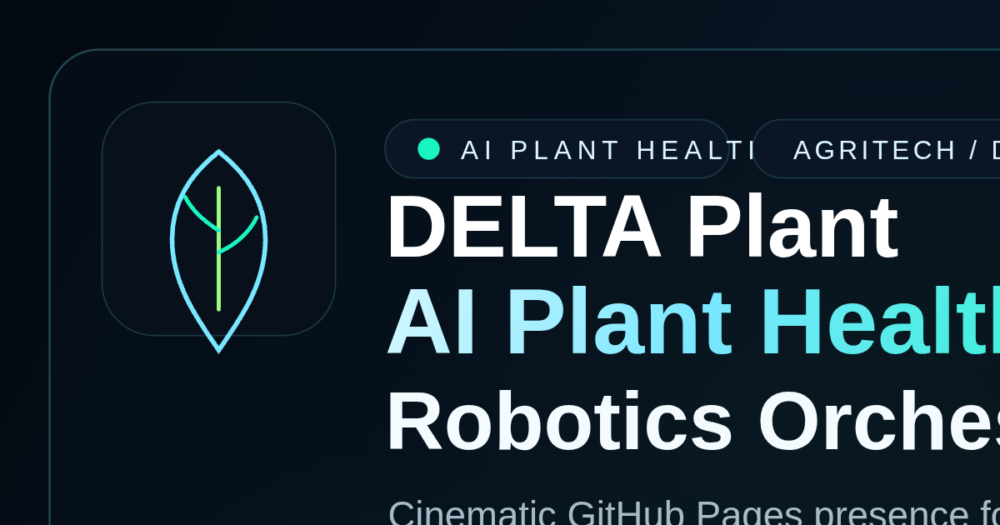

# DELTA Plant

[](https://doi.org/10.5281/zenodo.23273904)

### AI Plant Health and Robotics Orchestrator for Precision Agriculture

### AI Plant Health and Robotics Orchestrator for Precision Agriculture

<p align="center">
  <a href="https://proctor81.github.io/DELTA-PLANT/">
    
  </a>
  <a href="https://t.me/DELTAPLANO_bot">
    
  </a>
  <a href="https://github.com/proctor81/delta-plant">
    
  </a>
</p>

<p align="center">
  
  
  
  
  
  
  
</p>

DELTA Plant v4.0 is now officially in Production GA (General Availability): the project is out of beta and enters stable production operations for AI plant diagnostics, explainable edge vision, robotics orchestration, and precision agriculture workflows. It unifies leaf disease detection, sensor-aware reasoning, agronomic recommendations, DELTAPLANO conversational access, and deployment-ready operations for Raspberry Pi 5.

Built for researchers, agritech teams, biotech innovators, and venture capital audiences, DELTA Plant presents a differentiated narrative: cinematic product experience on GitHub Pages, production-oriented edge AI in the repository, and a clear bridge between research credibility and operational usability.

## Advanced DELTAPLANO LLM Workflows

DELTAPLANO now includes advanced bilingual agronomic reasoning for both Italian mode `Cris` and English mode `Ryan`. After each plant diagnosis, the bot keeps the latest diagnostic context and can refine it with new agronomic values or laboratory reports instead of forcing the operator to restart from a new photo.

| Workflow | What DELTA Does |
| --- | --- |
| Post-diagnosis agronomic refinement | Reworks the latest diagnosis using extra parameters such as pH, electrical conductivity, salinity, substrate, irrigation, nutrients, light, CO2, temperature, humidity, and other field observations |
| Scientific report reading | `/analisi` and `/analysis` accept PDF, JPEG, and PNG reports after a diagnosis: soil analysis, water analysis, fruit analysis, nickel/metals, pH/EC, nutrients, salinity, and other scientific/agronomic documents |
| Extraction stack | PDF text extraction with `pypdf`, image OCR with `pytesseract` and `Pillow`, plus Hugging Face Vision LLM fallback for JPEG/PNG reports when OCR is unavailable or insufficient |
| Bilingual voice/text consistency | Selecting Cris or Ryan now controls the written LLM response, Telegram captions, and TTS voice together; Ryan enforces English responses even when a voice transcript is in Italian |
| Controlled internal prompts | Diagnosis refinement uses `ChatEngine.chat_internal()` so manual knowledge-base routing and older conversation state do not distort the technical reassessment |

Operational flow:

```text
1. Run a DELTA Plant diagnosis in Telegram
2. Add values directly: "pH 5.5, EC 2.4 mS/cm, high salinity, low potassium"
3. Or run /analisi or /analysis and attach a PDF/JPEG/PNG laboratory report
4. DELTA returns a revised agronomic diagnosis, updated risk, corrective actions, and monitoring plan
```

Image uploads remain safe for normal plant diagnosis: JPEG/PNG files are treated as scientific reports only after `/analisi` or `/analysis`, or when the caption clearly indicates a lab/report context.

## Website Preview

The repository now includes a GitHub Pages-ready landing page in [website/index.html](website/index.html) with a cinematic space-meets-biology visual language, animated hero scene, ambient soundtrack controls, investor-facing storytelling, structured SEO metadata, and direct DELTAPLANO access.

<p align="center">
  <a href="https://proctor81.github.io/DELTA-PLANT/">
    
  </a>
</p>



| Preview Layer | What it Communicates |
| --- | --- |
| Hero experience | AI Plant Health, DELTAPLANO access, deep-tech visual identity, edge benchmarking, and cinematic motion design |
| Technology section | EfficientFormerV2-S1, LayerCAM explainability, hybrid edge vision, sensor fusion, and orchestration architecture |
| Demo and docs surface | Telegram bot, benchmark visibility, manual, model card, release notes, and GitHub repository pathways |

## Why DELTA Plant

- Edge-native AI plant health platform for real-world agritech environments
- Hybrid visual intelligence with MobileNetV2 production baseline and EfficientFormerV2-S1 optional backend
- Explainable AI with LayerCAM overlays for clearer diagnostics and stakeholder trust
- DELTAPLANO Telegram access for conversational operations and rapid field usage
- Sensor fusion, expert rules, quantum-inspired risk scoring, and agronomic recommendations
- GitHub Pages storytelling optimized for AI search, deep-tech discovery, and investor visibility

## Public Benchmark Snapshot

DELTA Plant publicly highlights a 600-image, 33-class PlantVillage validation sample as the main benchmark reference surface.

| Metric | Value |
| --- | --- |
| Public sample | 600 validation images |
| Coverage | 33 plant classes |
| General model top-1 accuracy | 89.33% |
| General model top-3 accuracy | 99.00% |
| EfficientFormer document estimate | 92.91% top-1 / 100.00% top-3 |
| Mean edge latency | 41.360 ms on Raspberry Pi 5 |

Reference artifacts:

- [Public benchmark report](logs/vision_eval/public_600_dual/BENCHMARK_600.md)
- [Benchmark summary JSON](logs/vision_eval/public_600_dual/comparison_summary.json)
- [Model card](MODEL_CARD.md)
- [Release notes](RELEASE.md)

## Core Technology

| Layer | DELTA Plant Capability |
| --- | --- |
| Edge vision | MobileNetV2 baseline plus EfficientFormerV2-S1 TFLite pipeline |
| Explainability | LayerCAM heatmaps and overlays for plant diagnosis interpretation |
| Orchestration | DELTA agent coordinating vision, sensors, diagnosis, and recommendations |
| Interfaces | GitHub Pages, DELTAPLANO bot, CLI, admin panel, optional REST API |
| Sensor intelligence | Temperature, humidity, pressure, light, CO2, pH, and EC |
| Agronomic LLM refinement | Post-diagnosis reassessment with manual agronomic parameters and scientific PDF/JPEG/PNG reports |
| MLOps pipeline | Training, export, evaluation, benchmarking, dissemination, manual regeneration |

## Product Highlights

- AI Plant Health landing page engineered for GitHub Pages and search visibility
- DELTAPLANO bot entry point for frictionless conversational interaction
- Scientific report-aware DELTAPLANO workflow for soil, water, fruit, nickel/metals, pH/EC and nutrient analysis
- Cris/Ryan bilingual operation with aligned written response, voice output, and diagnosis refinement language
- LayerCAM-powered explainable diagnosis with overlay-ready visual outputs
- Public benchmark storytelling aligned with v3.2 documentation surfaces
- Research-to-deployment positioning for agritech, biotech, and deep-tech narratives
- Edge execution pathway centered on Raspberry Pi 5 operations

## Quick Start

```bash
python -m venv .venv
source .venv/bin/activate
pip install -r requirements.txt
python main.py --preflight --enable-api --enable-telegram --daemon
```

Per usare la modalita voce del bot Telegram:

- imposta `HF_API_TOKEN` e `HF_MODEL_NAME` per la chat
- valore consigliato corrente: `HF_MODEL_NAME=Qwen/Qwen3-14B`
- DELTAPLANO usa `Piper` come provider TTS gratuito locale predefinito
- al primo utilizzo vocale, il modello italiano Piper viene scaricato automaticamente in `models/piper/`
- `edge-tts` resta disponibile come fallback gratuito
- opzionalmente imposta `ELEVENLABS_API_KEY` e `ELEVENLABS_VOICE_ID` solo se vuoi un provider premium
- usa `/voice auto`, `/voice on` oppure `/voice off` dentro Telegram

To preview the landing page locally:

```bash
cd website
python -m http.server 8080
```

Then open `http://localhost:8080` and browse the landing page from [website/index.html](website/index.html).

## Documentation Hub

- [Live website](https://proctor81.github.io/DELTA-PLANT/)
- [Access DELTAPLANO](https://t.me/DELTAPLANO_bot)
- [User manual PDF](Manuale/DELTA_Manuale_Utente.pdf)
- [Advanced Telegram LLM workflows](Manuale/DELTA_3.0_ARCHITECTURE.md#advanced-telegram-llm-and-report-refinement)
- [Technical architecture](Manuale/DELTA_3.0_ARCHITECTURE.md)
- [Model card](MODEL_CARD.md)
- [Release notes](RELEASE.md)
- [DELTA Orchestrator README](README_DELTA_ORCHESTRATOR.md)
- [LLM chat README](README_LLM_CHAT.md)

## Repository Structure

```text
ai/                 Training, export, evaluation, and TFLite tooling
core/               Runtime configuration and orchestrator logic
diagnosis/          Expert rules and diagnostic engine
interface/          CLI, admin panel, API, and Telegram integration
Manuale/            PDF manual generator and technical architecture docs
tools/              Benchmarking, dissemination, and pipeline automation
vision/             Vision backends including EfficientFormer classifier
website/            Landing page sources, SEO files, and social preview assets
```

## Audience Fit

DELTA Plant is designed to resonate with multiple high-value audiences without diluting the technical substance:

- Venture capital and deep-tech investors evaluating defensible AI infrastructure
- AI researchers exploring explainable edge vision and deployment realism
- Agritech and biotech teams looking for operational plant intelligence workflows
- Precision agriculture operators seeking interpretable, portable diagnostics

## Deployment Notes

The landing page is intentionally built with plain HTML, Tailwind CSS via CDN, custom CSS, and vanilla JavaScript inside [website/index.html](website/index.html) so it can deploy directly on GitHub Pages without a build step.

The repository also includes a GitHub Actions workflow that republishes a minimal `gh-pages` branch whenever the landing page files or social preview assets under [website/](website/) change on `main`.

## License

See [LICENSE](LICENSE) for repository terms.


## Citation

This repository is archived on Zenodo and can be referenced using the following DOI:

https://doi.org/10.5281/zenodo.23273904
